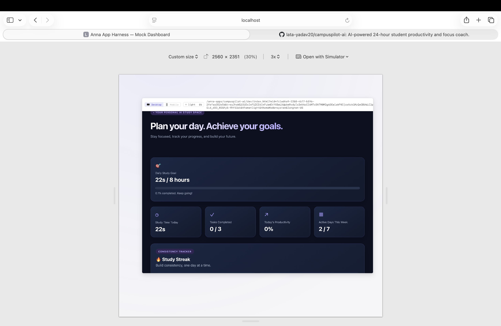
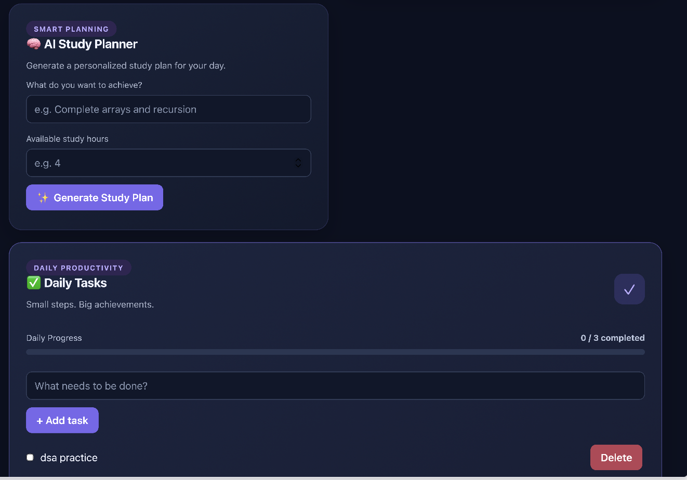
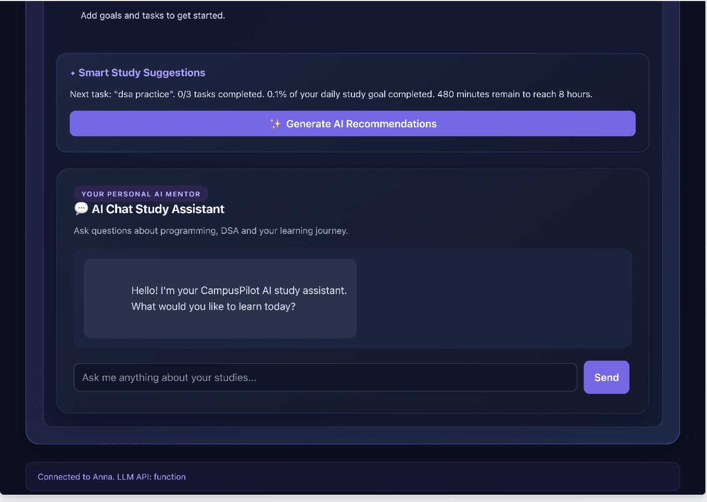
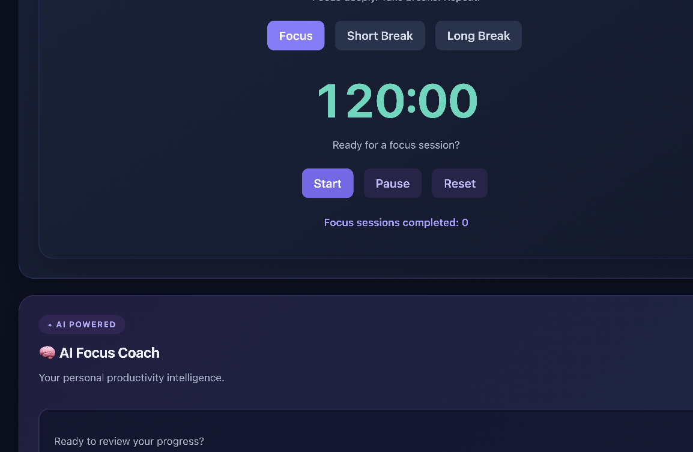
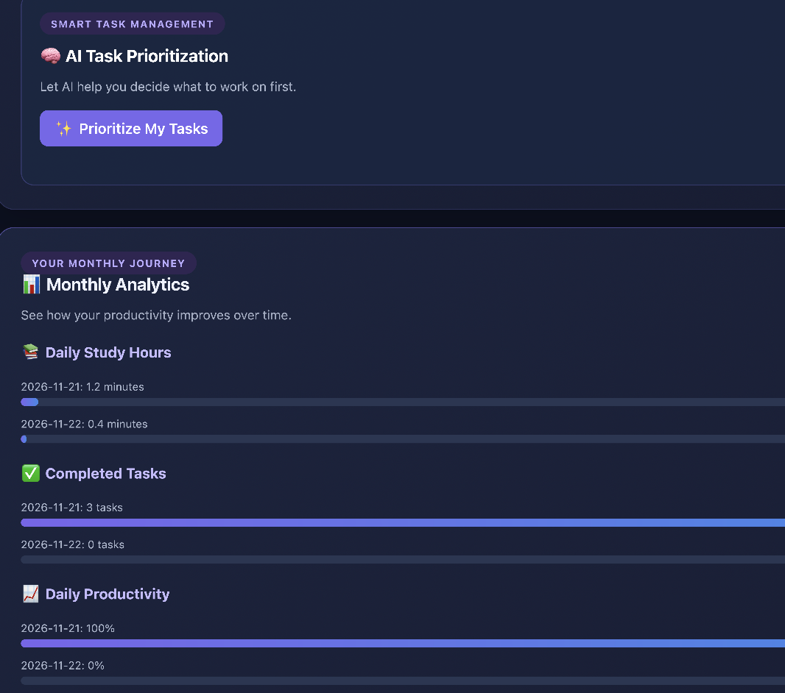
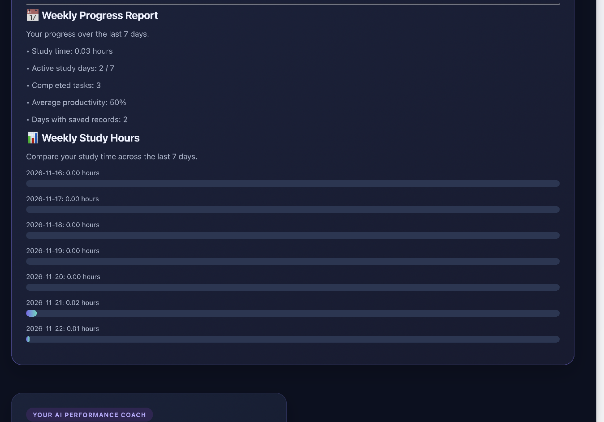
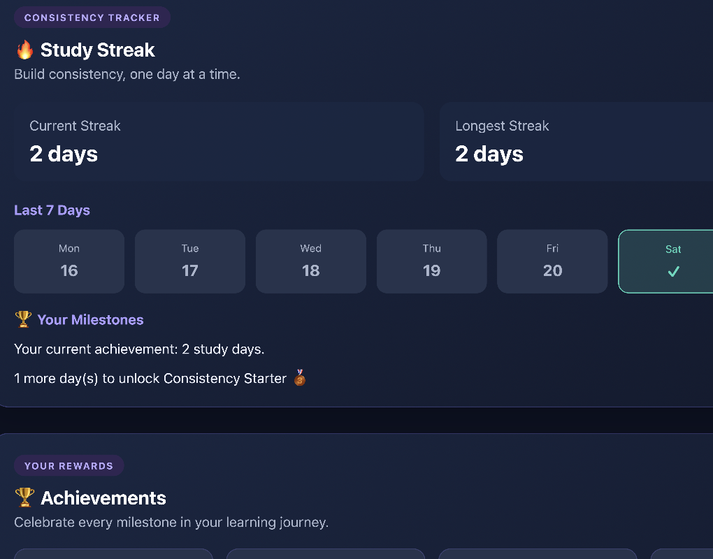
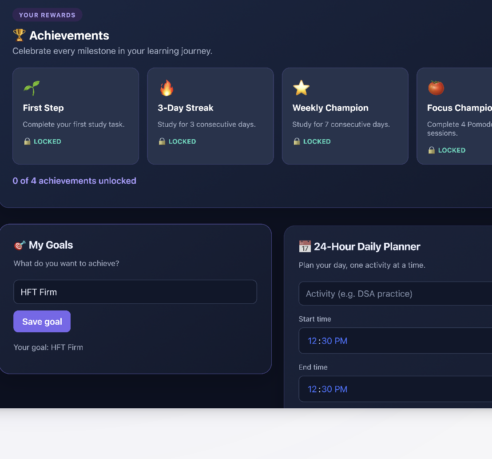
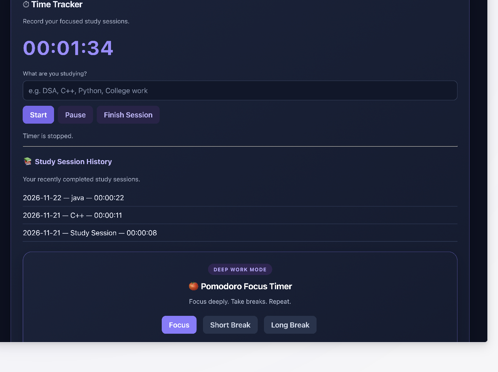
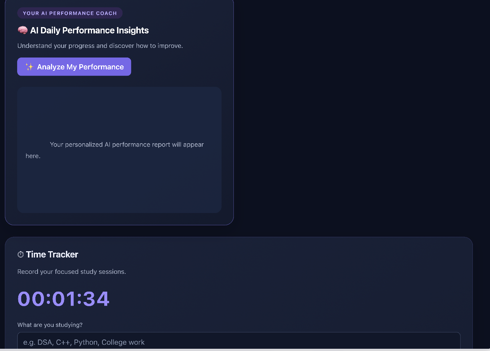

# ✦ CampusPilot AI

### Your Personal AI Study Companion

CampusPilot AI is an AI-powered student productivity dashboard designed to help students plan their studies, manage tasks, track progress, and stay focused.

## 🚀 Features

- **Study Dashboard** – Track daily study time, completed tasks, productivity, and active days.
- **AI Study Planner** – Generate personalized study schedules based on your goals.
- **Daily Planner** – Organize activities throughout the day.
- **Task Manager** – Add, complete, and delete daily tasks.
- **AI Focus Coach** – Receive personalized study guidance.
- **AI Chat Assistant** – Ask questions about programming, DSA, and learning.
- **Pomodoro Timer** – Use focus and break sessions to manage study time.
- **Study Analytics** – Monitor weekly and monthly study progress.
- **Study Streak Tracker** – Build consistent study habits.
- **Achievement System** – Celebrate learning milestones.
- **AI Task Prioritization** – Identify which tasks deserve attention first.
- 
- ## 📸 Application Screenshots

Explore the different features of CampusPilot AI:

### 1. Daily Study Goal


### 2. AI Study Planner


### 3. AI Chat Assistant


### 4. AI Focus Coach


### 5. Monthly Analytics


### 6. Weekly Progress


### 7. Study Streak Tracker


### 8. Achievement System


### 9. Time Tracker


### 10. Performance Insights


## 🛠️ Tech Stack

- HTML
- CSS
- JavaScript
- Anna App Runtime and LLM API

## 💻 Getting Started

### Run locally

1. Clone this repository:

   ```bash
   git clone https://github.com/lata-yadav20/campuspilot-ai.git
   ```

2. Open the project folder:

   ```bash
   cd campuspilot-ai
   ```

3. Start the development server:

   ```bash
   anna-app dev --storage aps
   ```

4. Open the local development URL shown in your terminal.

## 🎯 Project Goal

To make studying more organized, productive, and personalized through AI-powered tools.

## 👩‍💻 Author

**Lata Devi**

- GitHub: [lata-yadav20](https://github.com/lata-yadav20)

---

*Built with curiosity, creativity, and AI.*
